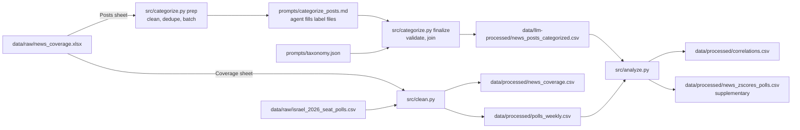

# Israel 2026 election: news coverage vs. coalition polls

Tracks weekly news coverage by theme against the governing coalition's average seat count in 2026 polls.

## Data and prompt layout

| Directory | Contents |
|---|---|
| `data/raw/` | Inputs: `news_coverage.xlsx` (25 outlets' main Facebook/Instagram posts, 16 Aug–3 Oct 2026; `Posts` sheet for categorization, `Coverage` sheet for cleaning, `README` sheet for collection notes; seven Sunday–Saturday weeks, with `week_id` as the Sunday date) and `israel_2026_seat_polls.csv` (fieldwork date, firm, publisher, party seats, and coalition seats in `Gov.`). |
| `data/llm-processed/` | `news_posts_categorized.csv`: UTF-8, one row per source post, joined by `item_id`. `work/` holds batch and label files during a categorization run; `finalize` deletes it. |
| `data/processed/` | Generated `news_coverage.csv`, `polls_weekly.csv`, `correlations.csv`, and supplementary `news_zscores_polls.csv`. |
| `prompts/` | Runnable `categorize_posts.md` and `taxonomy.json`. `src/categorize.py` does the categorization's data work: prep, checks and the final join. |

The prompt lists the taxonomy with numeric codes taken from `prompts/taxonomy.json` (`domains[].tags[]` and then `excluded`, in file order). `src/categorize.py` maps each code to its `topic`, `field` and `theme` and checks every label against the file.

## Pipeline



## Usage

```sh
uv sync
```

1. **Categorize.** Paste `prompts/categorize_posts.md` into an LLM coding agent at the repo root. The agent runs `src/categorize.py prep`, which auto-labels posts with no caption and merges duplicate captions. It then labels each remaining distinct caption with a taxonomy code and confidence in `data/llm-processed/work/labels/`, and runs `src/categorize.py finalize`. That writes `data/llm-processed/news_posts_categorized.csv` with `topic, field, theme, confidence` for every post in the `Posts` sheet.
2. **Clean.** Melts the `Coverage` sheet into `news_coverage.csv` and averages `Gov.` per Sunday week (week of the last fieldwork day) into `polls_weekly.csv`:

   ```sh
   uv run src/clean.py                     # all publishers
   uv run src/clean.py --exclude-ch14-i24  # without Channel 14 and i24 News
   ```

3. **Analyze.** `uv run src/analyze.py` drops `מחוץ לניתוח`, counts posts per `week, topic, field, theme` (missing weeks = 0), z-scores each count within its `topic, field, theme` across weeks (sample std), sets `poll_change(w) = gov(w+1) − gov(w−1)`, and writes the per-group Pearson correlation of z-score vs. `poll_change` to `correlations.csv`. Each correlation gets two-sided permutation p-values. Every ordering of the weekly `poll_change` values is applied to all groups at once; above 100,000 orderings, a seeded random sample of 100,000 is used. `p_value` compares a group's |r| with its own shuffled values. `p_value_adjusted` compares it with the largest |r| across all groups in each shuffle (max-T), which corrects for testing every group.

## Caveats

- These are social posts, not articles or broadcast segments; 38% have no caption, mostly Instagram.
- The weeks of 30 Aug and 6 Sep have about 30% fewer posts. It has not been checked whether this is a real dip or a collection gap.
- The permutation p-values treat weeks as interchangeable. They aren't: `poll_change` windows two weeks apart share a poll reading, and coverage carries over between weeks, so the p-values are optimistic.

Requires [uv](https://docs.astral.sh/uv/). Python 3.12 is pinned in `.python-version`; dependencies are declared in `pyproject.toml` and locked in `uv.lock`. `uv sync` creates `.venv`; `uv run` syncs it automatically.
